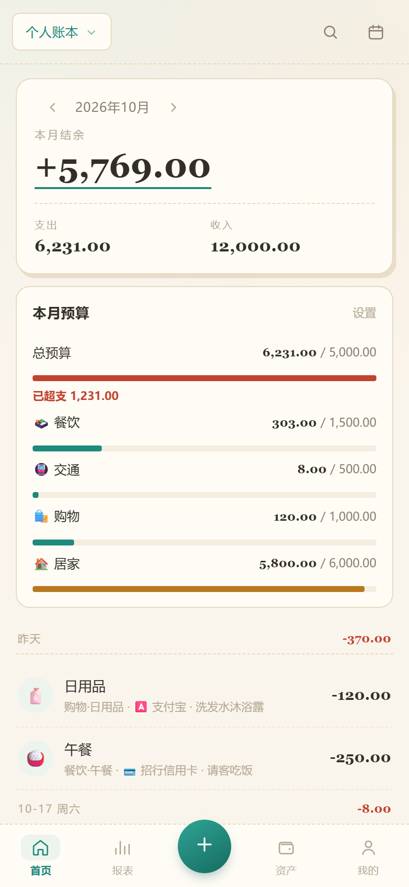
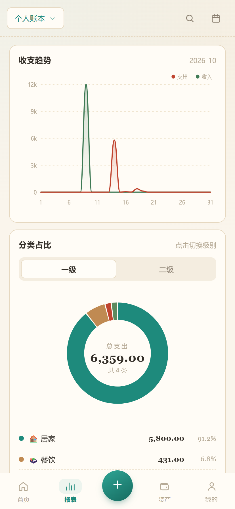
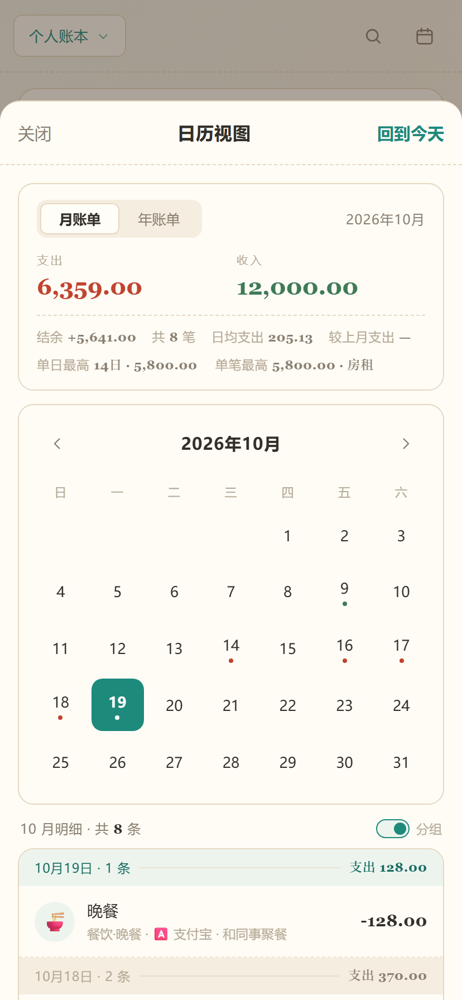
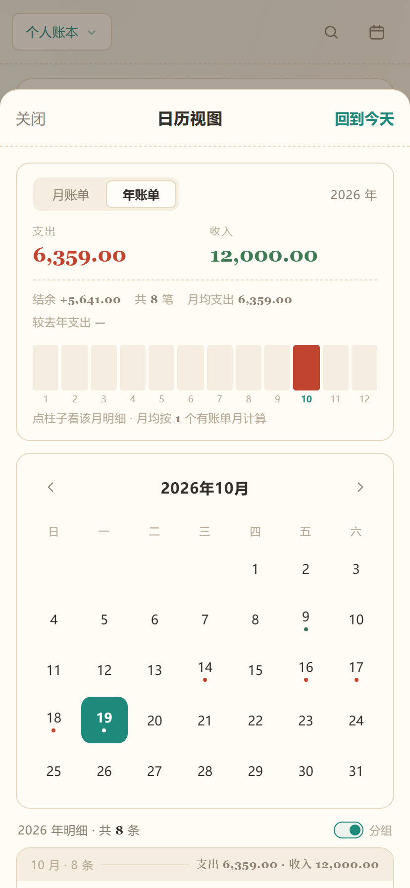
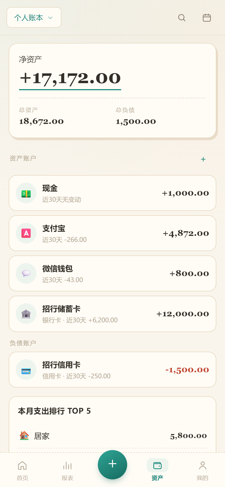
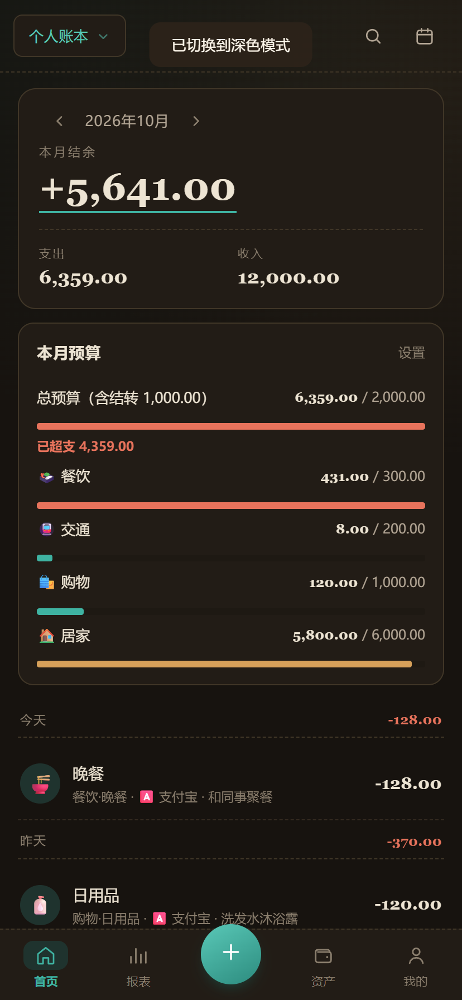
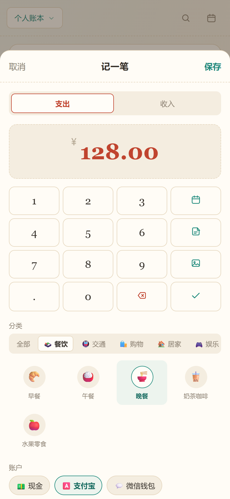
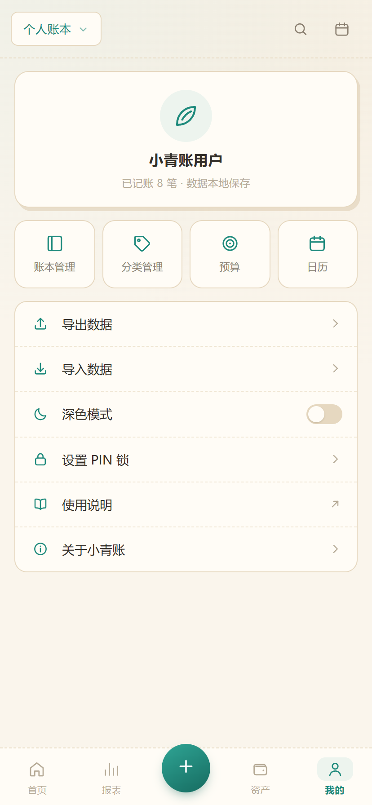

# 小青账

打开就能用的记账小工具。纸感手账风，不用注册、不用装 App，不联网也能记账，**记的账只存在你自己的浏览器里**。

👉 **在线使用**：https://a369096433.github.io/qingzhang/
👉 备用地址（官网打不开时用）：https://qingzhang-ledger-63298.app.workbuddy.host/
📖 **图文使用说明**：https://a369096433.github.io/qingzhang/guide.html

> 手机上打开后，用浏览器菜单里的「添加到主屏幕」，就和 App 一样有独立图标、全屏显示、没有地址栏。

---

## 看一眼界面

| 首页 | 报表 |
|---|---|
|  |  |

| 月账单 | 年账单 |
|---|---|
|  |  |

| 资产 | 深色模式 |
|---|---|
|  |  |

| 记一笔 | 我的 |
|---|---|
|  |  |

---

## 它能做什么

**记账**
- 支出、收入两类，数字键盘直接输入，可填备注、选日期、选账户
- 分类分两级（比如 餐饮 › 午餐），分类名字和图标都能自己改
- 退钱的时候可以关联到原来那笔支出，账目不会算重
- 长按任意一笔，可以改、可以再记一笔、也可以删

**查账**
- 首页按月看支出、收入、结余，往下是一笔笔明细
- 报表页有走势曲线和分类占比环形图，每类花了多少、占多少一目了然
- 日历页可以切「月账单 / 年账单」：先给汇总（支出、收入、结余、笔数、日均或月均、和上月/去年比），下面按日或按月分段，把每一笔都列出来
- 年账单里那排小柱子是 12 个月的支出，点哪个月就跳到那个月的明细

**管钱**
- 可以开多个账本（个人、家庭、旅行……数据各算各的），左上角一键切换，也能改名和删除
- 资产页建账户（现金、银行卡、支付宝、微信、信用卡都行），自动算总资产和负债
- 每个账本都能单独设月度总预算和分类预算，分类不够用可以自己加、自己删，快超支时进度条会变色

**其它**
- 搜关键词：备注、分类、账户、金额都能搜
- 导出 CSV / JSON 备份，也能把备份导回来
- 深色模式，纸感不变，只是底色换成暖黑
- 可以设 4 位 PIN 码，别人拿到手机也翻不了账

**AI 助手（可选，默认关闭）**
- 说一句话就能记账：「午饭 32 支付宝」，金额、分类、账户、备注自动填好
- 支付截图识别，一次可选多张，识别完逐笔核对再入账
- 报表页底部问 AI：这个月花得怎么样、上个月餐饮多少钱
- 需要你自己的 API Key，填在「我的 → AI 智能助手」；不填就完全看不到这些入口。账户需实名认证并有可用额度（余额为 0 时接口会返回 402）
- 浏览器直连模型服务商，没有中间服务器；详细步骤见[使用说明书](https://a369096433.github.io/qingzhang/guide.html)第 3.17 节

---

## 三分钟上手

1. **打开上面的链接**，点右下角那个「＋」，输入金额、选个分类（不确定就选「其他」），保存。第一笔就记完了。
2. **想加自己的分类？** 底部「我的」页 → 分类管理，可以新增、改名、换图标，比如加个「奶茶」「宠物」。
3. **想管住手？** 「我的」页 → 预算，设一个月度总额，用超了进度条会变色提醒。
4. **想复盘？** 底部「报表」看走势和分类占比；点首页右上角的日历图标，可以按月、按年翻明细。

更细的每一步操作，看[图文使用说明](https://a369096433.github.io/qingzhang/guide.html)，里面有截图。

---

## 你的数据在哪

- 全部存在**当前这个浏览器**里，不会上传到任何服务器，也不需要登录。AI 助手只在你自己启用后，把当次那句话或那张截图发给你选的模型服务商，不会上传整本账。
- 换手机、换浏览器、清理缓存之前，记得先「我的 → 导出数据」存一份 JSON。
- 反过来，换设备后把那份 JSON 导回去，账就回来了。
- 不同浏览器之间数据不互通，这是浏览器的隔离机制，不是 bug。

---

## 常见问题

**Q：打开后还是旧界面？**
A：浏览器缓存了，强制刷新一次就好（电脑 Ctrl / Cmd + Shift + R，手机把标签页关掉重开）。想确认版本，看「我的 → 关于小青账」底部的版本号和日期。

**Q：会不会哪天应用没了，我的账也丢了？**
A：账存在你的浏览器里，和网站是否在线没关系。但清缓存、清网站数据会把账一起清掉，所以**定期导出备份**最稳妥。

**Q：能多台手机同步吗？**
A：不能。这是个纯本地工具，没有账号和服务器。要在设备间搬账，用导出 / 导入。

**Q：能离线用吗？**
A：可以。页面第一次加载完就能断网用，也可以把 `index.html` 下载到本地双击打开。记账全程不需要网络，只有 AI 助手需要联网。

**Q：数据会被别人看到吗？**
A：不会。没有后端、没有埋点、没有广告，代码全在页面里，可以自己翻。真要更保险，设个 PIN 码。

---

## 更新记录

**v1.4 · 2026-10-24**
修了 AI 助手的两个毛病：一是用一句话记账总在转圈超时（默认模型是「会先思考再回答」的类型，光思考就要十几秒）；二是截图识别完全没反应（原来默认的视觉模型已被服务商下架）。现在会自动关掉模型的思考模式、模型被下架时自动换下一个，并把「余额不足」这类错误写成看得懂的中文提示。

**v1.3 · 2026-10-24**
新增可选的 AI 助手：一句话记账、支付截图识别（可一次多张）、报表页的月度洞察与问答。默认关闭，需要自己到硅基流动注册并填一个免费的 API Key 才会出现，浏览器直连、没有中间服务器，不填则和以前完全一样。设置路径「我的 → AI 智能助手」，图文步骤在说明书 3.17 节。
顺手把「记一笔」键盘上三个没用的按键去掉了（日期、备注、保存，对应功能本来就在别处），键盘改成三列，更好按。

**v1.2 · 2026-10-20**
本月预算对每个账本都开放（个人、家庭、旅行以及自己新建的账本）。没设过时，首页会显示醒目的「＋ 新增本月预算」按钮；设过之后点「修改」就能调整。

分类预算可以自己增删改了：点「新增分类预算」从已有分类里挑，也可以直接新建一个自己的分类（建完记账时也能选到），新建时还能从图标库里挑个图标；每行可改金额、改名、删除。账本列表每行也加了「修改 / 删除」按钮，个人账本和家庭账本同样能改名和删除。

**v1.1 · 2026-10-20**
日历支持月账单 / 年账单统计，并逐条列出每一笔记录；「我的」里加了使用说明入口。

**v1.0 · 2026-10-17**
第一个版本：记账、报表、资产、预算、日历、搜索、导入导出、深色模式、PIN 锁。

---

## 许可

MIT，随便用、随便改。

维护与发布说明见 [DEVELOPING.md](DEVELOPING.md)。
